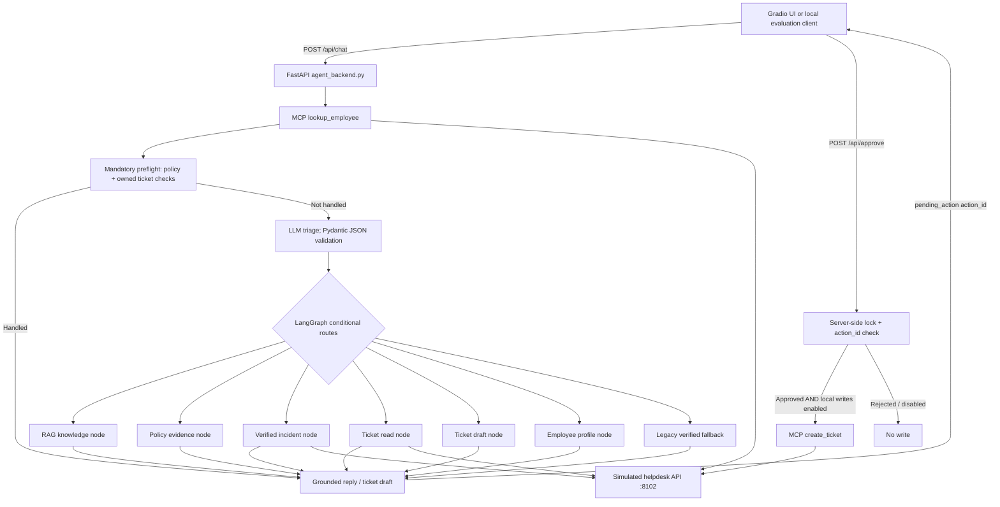

# Nakhla IT Helpdesk Agent — System Design (v2)

**Status:** course/local evaluation build · **Branch:** `v2-improvements` · **Date:** 12 November 2026

## 1. Scope and objectives

This is an educational agent built against the Nakhla Systems simulated helpdesk API, MCP server, employee directory, status feed, historical tickets, and a mixed Markdown/PDF KB. The project aims to provide sourced troubleshooting, policy-compliant ticket preparation, safe handling of incidents, and explicit human control before write actions. The supplied kit remains unchanged.

The backend is intentionally **loopback-only** and **not production-authenticated**. The local evaluation request supplies an email; a directory lookup verifies that the email exists, but does **not** prove the requester owns it. A real deployment would require server-side login, session binding, access controls, auditing, and secret management.

## 2. High-level components



**Critical trust boundary:** The LLM and the graph can *select candidate read/plan routes*; they cannot invoke MCP `create_ticket` or `add_ticket_note`. Only the FastAPI approval handler can write after validation of the server-owned draft and action token.

## 3. Message lifecycle and routing

1. `POST /api/chat` receives a `session_id`, `message`, and an evaluation `user.email`. The backend checks the email in the MCP employee directory; it clears context when the identity changes.
2. If `V2_LIVE_GRAPH=1`, `v2_backend_bridge.maybe_route` invokes `v2_live_flow.run_live_graph`. The Graph begins with a mandatory **preflight** that checks current company rules and ownership-verified ticket reads **before** calling the LLM.
3. Unhandled messages enter `v2_triage_graph`: an OpenRouter chat model proposes one of eight routes (`knowledge`, `policy`, `incident`, `ticket_read`, `ticket_create`, `employee_profile`, `clarify`, `unknown`). Pydantic forbids unexpected fields, validates intent/topic/confidence, and rejects invalid JSON.
4. Conditional edges dispatch only to explicitly registered executors. An invalid/unavailable model, low-confidence action, unsupported route, failed handler, or missing verified evidence falls back to the established backend rules. An LLM classification is *never* sufficient authority to draft a ticket.
5. The result preserves the course API contract: `reply`, `citations`, `tool_calls`, `pending_action`, `state`; successful approval may also include `result.ticket_id`.

**Current limitation:** This is an *incremental* migration. Some VPN/error-code flows, finance-specific handling, and incident decisions intentionally retain deterministic legacy checks. The Phase 3 graph is not claimed to be complete autonomous tool planning.

## 4. Retrieval-augmented generation and document authority

- The corpus comes from `dataset/knowledge_base/`, including Markdown and PDF. `ingestion.py` and `build_vector_store.py` provide chunking and embeddings; `retrieval.py` retrieves cosine-similar chunks via the configured embedding model.
- The backend loads only KB files with `status=current` and without `authoritative=false`. Deprecated, draft, and explicitly non-authoritative material is excluded.
- For known error messages, exact current-source evidence can take precedence over general semantic matches. For free-text requests, `choose_general_evidence` applies score and lexical relevance checks. A conservative title/catalog fallback helps cases such as `Wi-Fi` / `wifi` / `wireless` when embeddings miss a current document.
- Weak or ambiguous evidence yields an explicit **unknown / clarification**, not invented troubleshooting. Citations identify current approved documents such as `KB-003` for office Wi-Fi, `KB-015` for priority, and `SP-001` / `SP-002` for security.
- Source snippets and external tool results are untrusted data; they do not authorize bypassing policy, writing tickets, or changing the routing schema.

**Example verified behavior:** `How do I set up office Wi-Fi?` returned `state=langgraph_rag_answer`, citation `KB-003`, and instructions for Nakhla-Corp, Nakhla-Guest and Nakhla-IoT; no ticket was created.

## 5. MCP and ticket memory

`services/helpdesk_mcp.py` wraps the simulated helpdesk API on port 8102. The agent starts an MCP stdio subprocess and uses read tools such as `lookup_employee`, `search_tickets`, `get_ticket`, and `get_service_status`; the history router verifies ticket ownership before displaying a record. Ticket data forms *scoped memory*, not an unrestricted cross-user archive.

Current `agent_backend.mcp_call` opens a new stdio session per call. This design is simple and testable but imposes overhead. There is no claim of persistent MCP pooling or production observability.

## 6. Policy gate and deterministic safety invariants

| Invariant | Enforced by | Example |
|---|---|---|
| Contractor VPN restriction | `policy_first` + authoritative SP | Contractors use approved VDI rather than VPN tickets |
| MFA channel restriction | Mandatory policy rule + SP-002 | SMS/voice MFA is not an approved bypass |
| Security escalation | Policy preflight, source precedence | Compromised credentials / unexplained lockouts use documented escalation |
| Priority and user impact | `impacted_users`, `priority_for`, KB-015/016 | More than three affected users → P1; Executive Office → P1 |
| No duplicate confirmed incident ticket | Verified status/incident logic and fallback | `NX-503` is evaluated against current incident applicability |
| No cross-user ticket details | `ticket_memory_router` read checks | Tickets must be owned by verified directory email |
| No model-initiated write | Graph route guards and FastAPI approval | A ticket instruction in KB or LLM output cannot call `create_ticket` |

The preflight is applied even when a model labels a message `knowledge`. Model confidence is not a security credential.

## 7. Human approval and idempotency

```mermaid
sequenceDiagram
    participant User
    participant Agent as FastAPI / LangGraph
    participant MCP
    participant API as Simulated Helpdesk
    User->>Agent: Chat: Please open a ticket
    Agent->>Agent: Verify identity and policy; build payload
    Agent-->>User: pending_action + action_id, no ticket_id
    User->>Agent: POST /api/approve (approved=true, action_id)
    Agent->>Agent: Lock session and consume action_id
    Agent->>MCP: create_ticket(payload, idempotency_key=action_id)
    MCP->>API: POST /api/tickets with key
    API-->>MCP: ticket_id (e.g. IT-2001)
    MCP-->>Agent: Confirmed successful result
    Agent-->>User: state=created, result.ticket_id
    User->>Agent: Repeat same approval/action_id
    Agent-->>User: Cached original response (no new MCP write)
```

- A new chat turn invalidates the previous unapproved draft.
- The draft's `payload` and random `action_id` are generated server-side; `/api/approve` checks them under an async per-session lock.
- Rejecting a draft triggers **no write**. Replaying the same approve/reject decision returns its cached first outcome. A contradictory replay is rejected.
- Writing is gated by the process-level `EVAL_ENABLE_WRITES=1` switch **for isolated local course tests only**. Disabled writes return HTTP 403, even if the user approves.
- Ticket creation is considered successful only when the MCP response returns an actual ticket ID. The subject is truncated to **120 characters** to respect the simulated ticket schema.
- The idempotency cache is **in memory**, bounded, and not durable across restarts. A production implementation would need persistent idempotency and authentication.

**Verified live example:** an Outlook calendar syncing request returned `state=langgraph_awaiting_approval`, category `email_collab`, priority `P3`, pending action, and no `create_ticket` call. CH-10 subsequently created simulated `IT-2001` only after approval, category `network_access`, priority `P1`, `affected_users=5`.

## 8. Testing and measurements

The submitted project uses the **unmodified course evaluator**, an additional 14 own cases, and a separate 14-case challenge suite. Unit/contract tests cover replay, current document selection, policy precedence, source verification, graph routing and ticket-schema compliance. The final logged results were **10/10 kit**, **14/14 challenge**, and **14/14 own cases** on their respective runs; see [docs/EVALUATION.md](docs/EVALUATION.md) for timestamps/context and important differences among runs.

The last logged kit run measured average turn latency **4.28s** and p95 **7.23s**. LangGraph added routing flexibility but also a model call and additional latency. We do **not** claim that the instructor's hidden tests passed or that this corresponds to a final grade.

## 9. Trade-offs, residual risks, and next work

1. **Authentication:** Caller-supplied email and loopback binding suffice only for the *course simulator*, not a real enterprise. Require authenticated principals and ACLs before public deployment.
2. **Graph completeness:** Fallback paths remain outside the new graph for known VPN/security cases. Migrate only after matching status, policy, and approval tests.
3. **Performance:** Opening an MCP subprocess per call plus LLM triage increases mean latency; add safe pooled transport, caching, tracing and timeout budgets after benchmarking.
4. **Source coverage:** Conservative grounding may abstain on legitimate queries; review KB authority, spelling normalization and paraphrase tests without weakening policy constraints.
5. **Durability:** In-memory sessions and approval replay vanish on server restart; a production service would require durable session and action storage.
6. **Operational hardening:** The local flag-based write control is not enterprise authorization. Add audit logging, rate limiting, monitoring, secrets rotation, and a deployment-ready container/healthcheck configuration.
7. **Evidence:** The 10 supplied kit cases are not the 16 hidden cases. Only the instructor can confirm whether external hidden scoring improved.

## 10. Reproducibility and ownership

- **Kit-owned, untouched:** `services/`, `dataset/`, `evals/run_evals.py`, `evals/cases.sample.jsonl`.
- **Our code:** `agent_backend.py` modifications, `ticket_memory_router.py` modifications, and `v2_*.py` components.
- **Our evaluations:** `evals/cases.v2-own.jsonl`, `nakhla_v2_challenge/cases.v2-challenge.jsonl`, `tests_v2/`, and committed scorecards.
- **Local-only files excluded:** `.env`, API keys, `*.bak`, local Gradio certificates, generated cache/temp files.
- **Demo recommendation (3 minutes):** show Wi-Fi grounded answer; prohibited policy answer; Outlook ticket draft without write; approval creating ticket once; repeated approval avoiding duplicate; one verified incident/fallback; display scorecards.
